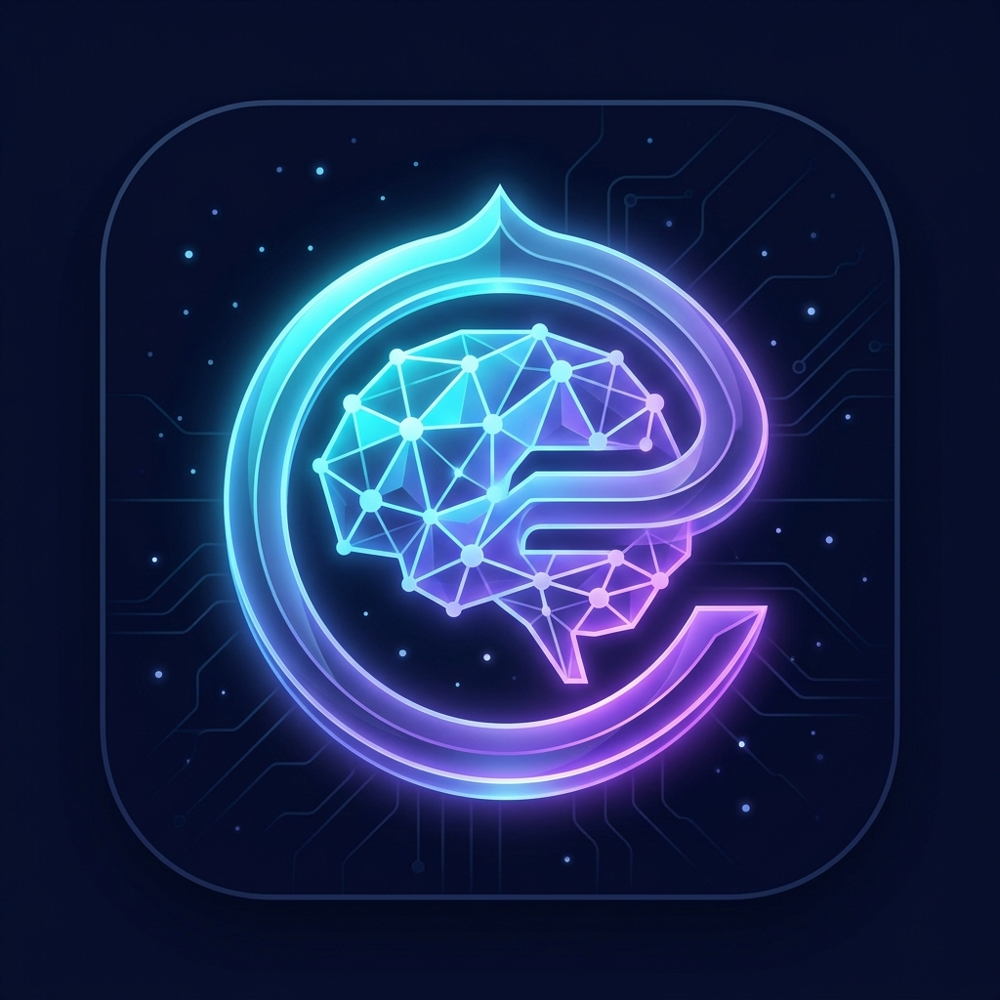

<div align="center">

  

  # 🧠 EdNova
  ### GenAI Peer-Learning Companion

  [](https://nextjs.org/)
  [](https://www.typescriptlang.org/)
  [](https://tailwindcss.com/)
  [](https://www.postgresql.org/)
  [](https://stripe.com/)

  *A real, working GenAI peer-learning companion that mediates, tutors, and facilitates — making learning structured, inclusive, interactive, and personalized for students and collaborative study groups.*

</div>

---

## 🌟 Overview

**EdNova** is an intelligent AI study companion designed to empower students. Rather than simply giving away solutions, EdNova balances **Socratic hint-first guidance** on practice problems with **instant, comprehensive explanations** on conceptual queries.

Key pillars:
- **Intelligent Intent Routing** — Progressive hints for problem-solving; immediate worked explanations for conceptual inquiries.
- **Dual Inference Engine** — High-speed compact model (**Fast Mode** via `qwen2.5-3b`) and deep pedagogical reasoning (**Thinking Mode** via `llama3.1-8b`).
- **Token Economy & Treasury** — Built-in study token system powered by Stripe with quiz rewards and session top-ups.
- **Collaborative Peer Rooms** — Real-time group study rooms with AI mediation and participation balancing.
- **Active Recall & Mastery** — SM-2 spaced-repetition flashcards, interactive quizzes, and Pomodoro focus timers with procedural audio alarms.
- **Multilingual Support** — Native support for English, French, Modern Standard Arabic (RTL), and Tunisian Darija (including Arabizi).

---

## ✨ Features

### 1. 🧠 Adaptive Socratic AI Tutor
- **Dual Inference Modes**: Switch seamlessly between **Fast Mode** (`qwen2.5-3b`, 25 tokens) for rapid answers and **Thinking Mode** (`llama3.1-8b`, 100 tokens) for deep pedagogical derivations and multi-step reasoning.
- **Conditional Pedagogical Routing**:
  - **Direct Questions & Problem-Solving**: Prompts **Socratic Nudge 1 of 3** upfront with progressive clues to foster critical thinking.
  - **Conceptual Explanations**: Immediately provides structured, clear explanations with analogies and examples.
- **On-Demand Flexibility**: Switch anytime using **"💡 Get Socratic Hint"** on explanations or **"📖 Show worked answer"** on problem nudges.
- **Gemini-Style Response Tuning**: Quickly modify any response to be *Shorter*, *More Detailed*, *Simpler (for beginners)*, *Real-World Analogy*, or *Generate Practice Problem*.
- **Multi-Turn Chat Sessions**: Independent viewport scroller, sticky bottom prompt bar, auto-scroll to latest, copy response, text-to-speech read-aloud, and `.md` session exports.

### 2. 🪙 Study Token Treasury & Stripe Checkout
- **Integrated Token Economy**: Students utilize study tokens for AI queries and earn tokens through mini-quizzes and focus streaks.
- **Stripe Checkout**: Secure Stripe payment flow supporting multiple token bundles (Starter 5k, Scholar 15k, Master 40k) with automatic webhook verification and local test fallbacks.
- **Self-Healing Balances**: Persistent PostgreSQL user balance tracking synchronized across devices.

### 3. 🔁 Spaced Repetition & Flashcard Studio
- **SM-2 Memory Algorithm**: Scientifically proven scheduling algorithm calculating optimal intervals and ease factors (New → Learning → Mastered).
- **Quality Ratings**: Review cards with *Again*, *Hard*, *Good*, or *Easy* to calibrate personal retention curves.
- **Revision Note Integration**: Automatically generate complete flashcard decks from uploaded lecture notes or revision summaries.

### 4. 👥 Collaborative Group Learning Rooms
- **Real-Time Peer Rooms**: Study together in synchronized virtual rooms using 6-character room codes.
- **AI Socratic Mediation**: The AI mediator monitors group discussions, checks factual accuracy, identifies participation imbalances, and gently prompts quieter peers.
- **Group Discussion Summaries**: Synthesize collaborative study sessions into structured revision notes.

### 5. 🎮 Gamified Quizzes & Recall Brain-Checks
- **1-Question Brain-Checks**: Quick recall quizzes triggered during long thinking inferences to keep students engaged and reward XP (+15 XP).
- **Interactive Multi-Question Quizzes**: Generate customized quizzes on any subject with detailed answer explanations and live scoring.
- **XP, Levels & Badges**: Earn experience points, unlock achievement badges, and track daily study streaks.

### 6. ⏱️ Focus Study Timer & Procedural Audio Alarms
- **Pomodoro Focus Timer**: Built-in presets (25m Focus, 50m Deep Work, 5m Break, 15m Long Rest) with circular SVG progress display and browser tab synchronization.
- **Procedural Web Audio Engine**: 5 synthesised alarm soundscapes (*Campus Bell*, *Upbeat Marimba*, *Zen Singing Bowl*, *Radar Pulse*, *Classic Clock*) with volume control, snooze, continuous ringing loop, and full-screen Zen mode.

### 7. 📚 RAG Knowledge Base & Lecture Note Uploads
- **Document Ingestion**: Upload course notes in `.pdf`, `.txt`, or `.md` formats.
- **BM25 Retrieval**: Fast local chunking and keyword retrieval injects top relevant excerpts into prompts with automatic source citations.

### 8. 🌍 Multilingual Pipeline
- **Four Languages Supported**: English, French, Modern Standard Arabic, and Tunisian Darija (Arabic script and Latin Arabizi).
- **RTL Support**: Full bidirectional layout mirroring for Arabic and Darija learners.

### 9. 📊 Learning Analytics & Cognitive Diagnostic
- **Onboarding Diagnostic**: Calibrates cognitive archetypes (*Adaptive Thinker*, *Visual Synthesizer*, *Deep Conceptualist*) and primary learning styles (*step-by-step*, *analogies*, *visual*).
- **Analytics Dashboard**: Visual charts (Chart.js) tracking study minutes, topic accuracy, subject breakdown, and focus consistency.

### 10. 🔐 Privacy & Authentication
- **Google OAuth Login**: One-click authentication with persistent profile synchronization.
- **Guest Demo Mode**: Instant anonymous study mode with full local storage persistence.

---

## ⚙️ Installation & Setup

### Prerequisites
- **Node.js** (v18.17 or higher)
- **npm** (or pnpm / yarn)

### 1. Install Dependencies

```bash
npm install
```

### 2. Configure Environment Variables

Create a `.env` file in the root directory by copying the template:

```bash
cp .env.example .env
```

Fill in your API keys and database credentials (see the [Environment Variables](#-environment-variables) section below).

### 3. Push Database Schema

Apply the Prisma schema to your PostgreSQL database:

```bash
npx prisma db push
```

### 4. Start the Application

```bash
npm run dev
```

Open [http://localhost:3000/ednova](http://localhost:3000/ednova) in your browser.

---

## 🔑 Environment Variables

Here is the complete template for your `.env` file:

```env
# ==============================================================================
# EdNova – Environment Configuration
# ==============================================================================

# Central AI Tutoring Service (OpenAI-compatible)
BASE_URL="https://your-llm-service.example/v1"
API_KEY="your-llm-api-key"
MODEL_FAST="qwen2.5-3b"
MODEL_LARGE="llama3.1-8b"

# Google Gemini (Multilingual translation & safety fallback)
GEMINI_API_KEY="your-gemini-api-key"
GEMINI_MODEL="gemini-2.5-flash"

# Google OAuth Authentication
GOOGLE_CLIENT_ID="your-google-client-id.apps.googleusercontent.com"
GOOGLE_CLIENT_SECRET="your-google-client-secret"

# PostgreSQL Database (Supabase / Prisma)
DATABASE_URL="postgresql://postgres:[PASSWORD]@[HOST]:6543/postgres?pgbouncer=true"
DIRECT_URL="postgresql://postgres:[PASSWORD]@[HOST]:5432/postgres"

# NextAuth / Session Secret
AUTH_SECRET="your-32-character-random-secret"

# Stripe Token Treasury & Checkout
STRIPE_SECRET_KEY="sk_test_..."
STRIPE_WEBHOOK_SECRET="whsec_..."
NEXT_PUBLIC_STRIPE_PUBLISHABLE_KEY="pk_test_..."

# Application URL
NEXT_PUBLIC_APP_URL="http://localhost:3000"
```

---

## 🛠️ Technology Stack

| Layer | Technology |
|---|---|
| **Framework** | Next.js 16 (App Router, Turbopack) |
| **Language** | TypeScript 5 |
| **Styling** | Tailwind CSS 4, Lucide Icons |
| **Database & ORM** | PostgreSQL (Supabase) + Prisma 7 |
| **Authentication** | Google OAuth + Session Tokens |
| **Payments** | Stripe Checkout & Webhooks |
| **AI Tutoring Engine** | Central LLM Service (`llama3.1-8b`, `qwen2.5-3b`) |
| **AI Translation** | Google Gemini 2.5 Flash |
| **Data Visualisation** | Chart.js + react-chartjs-2 |
| **Audio Synthesis** | Web Audio API (procedural oscillator soundscapes) |
| **Document Processing** | pdf-parse + BM25 Retrieval Engine |

---

## 📜 License & Copyright

© 2026 **EdNova**. All rights reserved.
